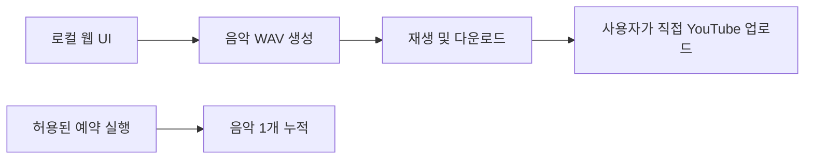

# AutoMusic

Lyria 기반 음악 자동 생성 프로젝트입니다. **배치 업로드는 비활성화했습니다.** `configs/upload.yaml`의 `batch_upload_enabled: false`가 기본이며 설정이 없어도 비활성입니다. 음악 생성과 웹 재생·WAV 다운로드는 유지하고 YouTube는 사용자가 직접 업로드합니다. 이미지 생성·MP4 취합·자동 업로드·`success/` 자동 이동은 수행하지 않으며 기존 결과는 보존합니다.



## 빠른 시작

### 이 작업 폴더의 기존 환경 사용

기존 가상환경이 준비되어 있습니다. 설치를 다시 하지 않고 프로젝트 루트에서 실행합니다.

```bash
cd /Users/dglee/workspace/autoMusic
.worktrees/automusic-pipeline/.venv/bin/python scripts/run_web.py
```

웹 UI: [로컬 작업실 열기](http://127.0.0.1:8765). 이미 실행 중이면 이 주소로 접속하세요. 같은 프로젝트의 웹 서버는 하나만 실행할 수 있습니다. 직접 실행한 서버는 해당 터미널에서 `Ctrl+C`로 종료합니다.

### 새로 설치하는 경우

아래는 기존 가상환경이 없는 새 설치용 명령입니다. 기존 `.env`가 있다면 보존하고 복사 단계를 건너뛰세요.

```bash
cd /Users/dglee/workspace/autoMusic
python3 -m venv .venv
.venv/bin/python -m pip install -r requirements.txt
test -e .env || cp .env.example .env
```

`.env.example`에 안내된 생성용 환경변수를 로컬 `.env`에 설정한 뒤 실행합니다. 키·토큰은 화면이나 공유 문서에 붙여 넣지 않습니다.

```bash
.venv/bin/python scripts/run_web.py
```

두 실행 방식 모두 기본 주소는 `127.0.0.1:8765`입니다. 다른 로컬 포트가 필요하면 `--port 8767`처럼 지정하세요. 외부 네트워크 공개는 지원하지 않습니다.

## 작업실 사용법

| 화면 | 할 수 있는 일 |
| --- | --- |
| 대시보드 | 완료 곡 수·전체 재생 시간·진행 작업과 최근 오류 확인, 새 음악 생성으로 이동 |
| 음악 생성 | 카테고리 직접 선택 → 변형 직접 선택 또는 랜덤 → 미리보기 → 프롬프트 편집 → 음악 만들기 |
| 라이브러리 | 기존 자동화·보관된 트랙·웹 생성 결과 검색, 출처 필터, 재생·탐색·WAV 다운로드·실제 프롬프트 확인 |
| 스케줄러 | 설치·등록·실행 상태 조회, 기존 자동화 켜기·끄기 및 실패 복구 |

미리보기에서 변형을 확정하며 생성할 때 다시 추첨하지 않습니다. 프롬프트는 생성 전 자유롭게 수정할 수 있고 **이번 생성에만 적용**됩니다. 원본 YAML은 바뀌지 않으며 새 초안은 이전 편집 문구를 자동으로 이어받지 않습니다. 미리보기의 설정 길이와 완성 음원의 실제 길이는 다를 수 있습니다.

**음악 만들기는 실제 생성 API를 호출합니다.** 접수 이후에는 입력이 잠기고 대기·생성 중·완료 또는 실패를 표시합니다. 웹 수동 생성 자체는 음악 WAV만 만듭니다. 라이브러리는 완료 시와 화면 진입 시 갱신되며, 재생은 사용자가 시작합니다.

연결 실패는 작업 실패를 의미하지 않습니다. 마지막 확인 결과를 유지하며, 접수 여부가 불명확하면 **같은 요청 접수 확인**으로 기존 식별자를 재사용하세요. 새로고침 후에는 같은 브라우저 탭의 세션 정보와 서버 작업 목록으로 상태를 복원합니다. 서버 재시작으로 중단된 작업은 자동 재생성하지 않습니다. 목록 새로고침과 새 생성은 별도 행동입니다.

시각·길이가 없으면 정보 없음으로 표시합니다. 목록을 읽지 못한 상태와 실제 빈 목록을 구분하며, 손상된 일부 항목은 건수로 안내합니다. 조회가 실패하면 각 화면의 새로고침을 이용하세요.

스케줄러는 상태 조회만으로 변경되지 않습니다. 켜기·끄기는 확인 후 실행하고 실제 상태를 다시 조회합니다. 현재 배치 비활성 설정에서는 예약 자동화가 음악만 생성합니다. 스케줄러를 켜거나 `--manual`로 실행해도 배치 비활성 설정을 우회하지 않습니다. 향후 배치 설정을 명시적으로 활성화한 경우에만 이미지·영상·업로드로 이어질 수 있습니다. 끄기는 이후 예약 실행을 막으며 이미 진행 중인 작업을 강제 종료하지 않습니다. 확인 불가 상태에서는 변경을 차단합니다. 지원·설치·등록 여부가 확인된 부분 실패는 켜기·끄기 재시도를 제공하며, 미등록으로 확인된 경우도 복구할 수 있습니다. 자세한 실패 대응과 운영 방법은 [운영 가이드](docs/program-guide.md)를 참고하세요.

## 자동화

`configs/category.conf`의 `music_category`를 읽어 선택된 카테고리 YAML을 사용합니다. 현재 카테고리는 `phonk`, `study`, `fitness`, `cafe`, `lofi`이며, `configs/categories/`에 YAML을 추가해 확장할 수 있습니다. 장르·분위기·악기·음악 arrangement를 읽어 실행할 때 음악을 누적합니다. 현재는 `batch_upload_enabled: false`이므로 곡 수가 `batch_count`에 도달하거나 미완료 배치가 있어도 배치를 건너뜁니다. 직접 `run_batch_upload.py` 실행도 `--dry-run`을 포함해 차단됩니다. 기존 트랙·배치·아카이브는 삭제하지 않습니다.

```bash
.worktrees/automusic-pipeline/.venv/bin/python scripts/run_automation.py \
  --manual \
  --project-root /Users/dglee/workspace/autoMusic
```

위 명령은 예약 gate를 우회하는 명시적 수동 실행이며 실제 음악 생성 비용이 발생할 수 있습니다. 배치 비활성 설정은 그대로 적용됩니다. 예약 경로에서는 `--manual` 없이 gate를 확인합니다. 새 설치 환경에서는 Python 경로를 `.venv/bin/python`으로 바꾸세요.

macOS 스케줄러를 처음 등록할 때의 명령입니다. 상태 조회용 명령이 아니며 실제 예약을 등록합니다.

```bash
.worktrees/automusic-pipeline/.venv/bin/python scripts/install_launchd.py \
  --project-root /Users/dglee/workspace/autoMusic \
  --python-path /Users/dglee/workspace/autoMusic/.worktrees/automusic-pipeline/.venv/bin/python \
  --hour 12 --minute 0
```

새 설치 환경에서는 실행 Python과 `--python-path` 모두 새 `.venv` 경로로 바꾸세요. 현재 설치·활성 여부는 웹 스케줄러 화면에서 별도로 조회합니다.

## 팀 운영

총괄운영자가 디자인·프론트엔드, 백엔드, QA·운영 담당의 파일 소유권과 결과를 관리합니다. 상세 규칙은 [AGENTS.md](AGENTS.md), 역할별 범위는 [디자인·프론트엔드](agents/design-frontend.md), [백엔드](agents/backend.md), [QA·운영](agents/qa-infra.md)에 있습니다.

각 Phase 종료 시 산출물, 검증 근거, 미해결 사항을 보고하고 **“다음 단계로 진행할까요?”**라고 묻습니다. 사용자의 명시적인 **“진행”** 답변 전에는 다음 Phase를 시작하지 않습니다. 담당자는 결론 3줄과 다음 단계 1줄로 보고하며, 사용자와의 확인은 총괄만 수행합니다.

산출물은 `outputs/<작업명>/<phase>/`에 저장하며 사실·추정·확인 필요를 구분합니다. 확인되지 않은 환경은 추정하지 않습니다. 배포 승인은 대상 커밋, 실제 명령, DB 변경 여부와 복구 방법을 포함합니다. 현재 대시보드 작업의 [Phase 1 보고서](outputs/local-dashboard/phase-1/report.md)는 로컬 산출물이며 Git 추적 여부는 별도로 확인합니다.

## 운영 문서

- [전체 운영 가이드](docs/program-guide.md)
- [보안 및 커밋 안전 가이드](docs/security.md)
- [문서 홈](docs/README.md)

현재 생성 결과는 `workspace/`에 보존되며 웹 결과를 다운로드해 사용자가 직접 YouTube에 올립니다. 수동 업로드만으로 로컬 파일이 `success/`로 자동 이동하지 않습니다. 과거 `success/` 결과도 그대로 조회할 수 있습니다. 배치 설정을 명시적으로 활성화한 경우에만 기존 자동 업로드·아카이브 흐름이 동작합니다. API 키와 OAuth 토큰은 환경변수로만 읽습니다.
